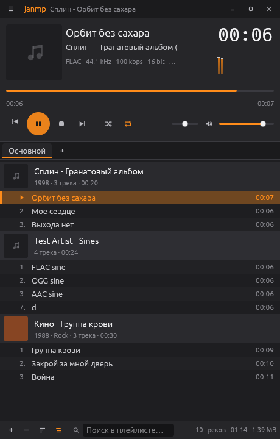

# janmp

Desktop music player in the spirit of AIMP, written in Rust with [egui](https://github.com/emilk/egui).
Музыкальный плеер для рабочего стола в духе AIMP на Rust и egui.



## Build / Сборка

```sh
# Linux: sudo apt install libasound2-dev
cargo run --release -- [files or folders to play]
```

Settings and playlists are stored in the platform config directory
(`~/.config/janmp`, `%APPDATA%\janmp`, `~/Library/Application Support/janmp`).

## Architecture / Архитектура

```
src/
├── main.rs            window setup (eframe)
├── app.rs             app state, playback order (queue, shuffle, repeat), events, hotkeys
├── audio/
│   ├── stream.rs      internet radio decoder: network → ffmpeg/Symphonia → jitter buffer
│   ├── ffmpeg.rs      external ffmpeg decoder (raw f32 over a pipe) + banner parser for tags
│   ├── engine.rs      engine thread: Player handle (commands/events), gapless hand-off,
│   │                  lock-free position/volume/visualizer state shared with the UI
│   ├── decoder.rs     AudioDecoder trait + Symphonia backend (sample-accurate seek)
│   ├── output.rs      cpal output stream fed by an rtrb ring buffer, click-free pause, balance
│   ├── resample.rs    streaming rubato FFT resampler (source rate → device rate)
│   ├── cdda.rs        audio CD: .cda files (Windows), TOC + raw sector reads (Linux)
│   ├── ape.rs         built-in Monkey's Audio decoder (frame-accurate seek)
│   ├── ytdl.rs        YouTube & co. via yt-dlp (direct audio URL, cached) decoded by ffmpeg
│   ├── midi.rs        MIDI / RMI decoder: SoundFont synthesis, seek by fast replay
│   ├── eq.rs          18-band biquad equalizer (runs in the audio callback)
│   ├── replaygain.rs  ReplayGain / R128 tags → per-track gain
│   ├── formats.rs     extension → backend table
│   └── vis.rs         lock-free sample tap for the spectrum analyzer
├── playlist/
│   ├── mod.rs         Track / Playlist, sorting, selection, grouping keys, folder scanning
│   ├── cue.rs         CUE sheets (UTF-8 and CP1251)
│   └── m3u.rs         M3U/M3U8/PLS read, M3U8 write
├── radio/
│   ├── http.rs        stream connection (incl. "ICY 200 OK" servers), ICY metadata stripping
│   └── record.rs      recorder: raw stream copy, WAV, or ffmpeg-encoded formats; split per song
├── meta.rs            background tag reading (lofty) and cover art (embedded / folder.jpg)
├── stats.rs           listening statistics, ratings / auto-ratings, bookmarks (library.json)
├── config.rs          settings + playlists persistence (JSON)
├── hotkeys.rs         configurable local hotkeys and system-wide ones (global-hotkey crate)
├── i18n.rs            English / Russian strings (with Russian plural forms)
└── ui/                AIMP-like skin, player panel, spectrum, playlist view, custom widgets
```

The audio path is `decoder → channel mapping → resampler → ring buffer → cpal callback`.
The engine thread owns decoding; the realtime callback only copies samples, applies volume /
balance / pause ramp and feeds the visualizer. When a track is about to end the engine emits
`AboutToFinish`, the app enqueues the next item and it is decoded straight into the same buffer,
so playback is gapless.

## Status / Статус

Done:
- Built-in (pure Rust): APE (Monkey's Audio 3.95+), MP1/MP2/MP3, FLAC, OGG Vorbis, WAV, AIFF, M4A/M4B/MP4 (AAC-LC, ALAC), CAF, MKA/WebM
- Through FFmpeg (found via `$JANMP_FFMPEG`, next to the executable, or in `PATH`): older APE, WMA, AC3,
  DTS, MPC, TAK, TTA, WavPack, OptimFROG, Speex, Opus, DSF/DFF, AA3/AT3/OMA, and tracker modules
  (IT, MOD, MO3, MTM, S3M, UMX, XM, MDZ/ITZ/S3Z/XMZ…) via libopenmpt, which common FFmpeg builds include
- MIDI / RMI by SoundFont synthesis (rustysynth): pick a .sf2 in Settings, or janmp finds
  `soundfont.sf2` next to the executable or a system one (e.g. `/usr/share/sounds/sf2`)
- Audio CD: Menu → Add audio CD. On Windows the drive's `TrackNN.cda` files play by reading
  raw CDDA sectors; on Linux the disc's table of contents is read from `/dev/sr*` (untested on
  real drives so far). macOS mounts audio CDs as AIFF files, which play as usual
- 18-band equalizer (31 Hz – 16 kHz) with preamp, built-in and your own presets; applied in the
  output callback, so changes are heard immediately
- ReplayGain by track or album (also Opus R128 tags), preamp, gain for untagged files, clipping
  protection from peak values
- Gapless playback, sample-accurate seeking, resampling to the device rate
- CUE sheets (including CP1251), M3U/M3U8/PLS import, M3U8 export
- Multiple playlists (tabs), grouping by album / artist / folder / genre / year, sorting, search
- Play queue, shuffle, repeat (playlist / track)
- Tags and cover art, spectrum analyzer, borderless AIMP-like window, EN/RU interface
- Internet radio: HTTP/HTTPS and SHOUTcast/Icecast (ICY) streams in MP3, OGG, AAC, AAC+ (via
  FFmpeg), "now playing" titles, jitter buffer, auto-reconnect; stations from URL, M3U or PLS
- YouTube (MPEG-DASH audio), SoundCloud and Bandcamp through yt-dlp + FFmpeg: add a video or a
  whole playlist by URL; titles, artists and durations are filled in, and the next entry is
  resolved in advance so it starts without a pause
- Radio recording: the original stream byte-for-byte (lossless for MP3/AAC/AAC+), or APE and WAV
  (built in), FLAC, OGG, WavPack, WMA, MP3 (through FFmpeg); optionally a new file for each song
- Listening statistics (plays, skips, listening time, top tracks and artists, recently played)
- Ratings: your own 1–5 stars, or an automatic rating from plays vs. skips until you set one
- Bookmarks: save a position inside a track and jump back to it (Ctrl+B)
- Configurable hotkeys (Menu → Configure hotkeys): local ones work in the window and follow the
  physical key, so they work with any keyboard layout; global ones work system-wide (defaults
  Ctrl+Alt+Home/End/PageUp/PageDown/↑/↓), plus multimedia keys. Global hotkeys need X11, Windows
  or macOS; Wayland does not allow them

Roadmap:
- MPRIS / Windows media controls integration
